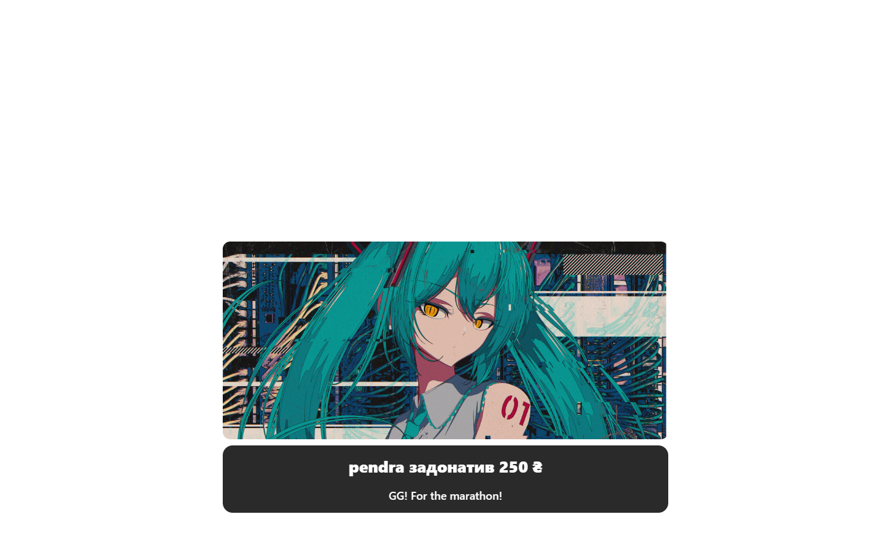

# LocalMonoDonate

A local Windows app for **Monobank donation alerts** — it watches your Monobank jar(s) and turns
incoming payments into on-stream alerts, a sound-alert deck, a marathon timer, an auction and
StreamElements tips. Single Rust executable with a WebView2 UI; no cloud service, no account,
nothing leaves your machine except the requests the app itself makes.

> Monobank is a Ukrainian bank. Amounts are shown in the jar's own currency (`₴`, `$`, `€`, …).

## Screenshots

| Setup | Donation page |
|---|---|
|  |  |

| Sound alerts (bits) | Alert styles |
|---|---|
|  |  |



---

## Features

### Donations
- Watches one or several Monobank jars (up to 5) using your personal API token.
- Matches a payment to a pending donation **by code** embedded in the comment, or **by amount + recency**.
- Pending donations are created by the public donation page (name, amount, message, YouTube link, voice, sound alert).
- Every positive transaction is stored in local history and stats, matched or not.
- Anonymous donations are supported (`Anonymous` when no nickname is given).

### Alerts
- Full-screen overlay (`/main`) with your own background image/video and alert styles per amount range.
- Optional announcement voice and a sound/voice clip on the overlay.
- Notify rules editor (`/notify`) — several amount ranges, each with its own style, timings and TTS text.
- Optional YouTube request: a donation with a YouTube link plays the video in the overlay after the alert.

### Sound alerts (bits)
- A deck page (`/bits`) where viewers buy a sound/video/image "bit" for a fixed price.
- Optional nickname field on that page: the alert is counted as `<nick> SA`, or `Anonymous SA` when empty — sound-alert spend stays separate from normal donations in stats and StreamElements.
- Bits can also be attached to a normal donation on the donation page.

### Marathon timer
- Adds time per donation (`amount / per_amount * per_seconds`).
- Adds time for Twitch subs, gifted subs and resubs (tiers 1/2/3 configurable).
- Start / pause / add / subtract / reset from the admin page (`/timeradmin`); overlay at `/timer`.

### Auction
- Bids from donations, channel-point redemptions and manual entries.
- Optional lots, pinning, adjustments, source filter and dedup; separate auction UI (`/auction`).
- Winner picking, timers and history are kept locally.

### Twitch
- Local OAuth (no public redirect needed) + EventSub over WebSocket — **no Cloudflare worker**.
- Reads subs/gifted subs/resubs for the timer and channel-point redemptions for the auction.
- Can create the channel-point reward(s) for you.

### StreamElements
- Mirrors every live donation and sound alert as a StreamElements **tip** (right currency) so the SE
  alert box can play, plus a matching activity so it appears in the **Activity feed** and dashboard
  stats (converted to USD, since SE totals are USD-only).
- Tippers are grouped by **nickname only**: the same nickname is one tipper regardless of card or
  email, and two different nicknames never merge.
- Hard on/off switch — disabled means the app sends StreamElements nothing at all.

### Voices (TTS)
- **Default: Google Ukrainian + Google English** — free, no key, needs internet.
- **Azure (optional):** paste your own Speech key and region in *Alerts → voice set*; Azure voices
  only appear in the picker when both are filled in.
- **Custom StyleTTS2-UA voices:** only in full builds that include the ~157 MB StyleTTS2 model.
  The lite release ships Google/Azure only, so the “custom” voice set is hidden automatically.

### Publishing & helpers
- **Tailscale is the supported way to make the donation page public** (see below), bundled installer included.
- Local `*.localhost` links for every page, so OBS can use clean URLs.
- EN / UA interface, switchable at runtime.
- Background media, custom fonts, grid sizes for the deck, etc.

---

## Install (Windows 10/11 x64)

Grab the latest **MONOBANK-lite-*.zip** from [Releases](../../releases), unpack it anywhere and run
`LocalMonoDonate.exe`.

The zip is self-contained:

| Included | Why |
|---|---|
| `LocalMonoDonate.exe` | the app |
| `WebView2Loader.dll` | WebView2 hosting |
| `MicrosoftEdgeWebview2Setup.exe` | silent install if WebView2 is missing |
| `tailscale-setup.msi` | one-click public donation page |
| `tts-engine\` | portable Python + Google/Azure voices (no custom StyleTTS voices) |
| `config.example.json` | shape reference only — the app never reads it |

No Node, no Python, no Rust, no installer. Settings and tokens are created on first run in
`%APPDATA%\LocalMonoDonate\` — never in the app folder.

> SmartScreen may warn because the exe is unsigned. “More info → Run anyway”.

---

## First-time setup

1. **Monobank token** — get a personal token at <https://api.monobank.ua> (Monobank app → Settings → API).
   Paste it into *Setup → Monobank API token*.
2. **Jar** — copy only the code from your jar link: `send.monobank.ua/jar/<CODE>`. Add it under
   *Setup → Jar code(s)*. Mark it “My jar” (third-party jars only get a payment link, no tracking).
3. **Nickname** — used in every local link (`<nickname>.localhost`). Only links with this exact prefix
   work; rename it and old links stop working (404).
4. **Save**. The donation page is at `http://<nickname>.donate.localhost:8787/banka`.
5. **Tailscale — required for viewers.** A page on your PC is not reachable from a phone or another
   network. Press *Connect Tailscale* (the installer ships next to the exe), log in once, and the
   donation page is published at `https://<tailnet>/<nickname>/donation`.
6. *(Optional)* **Twitch** — create an app at <https://dev.twitch.tv/console/apps> (confidential),
   add the redirect URL shown in Setup, paste Client ID/Secret, press *Authorize Twitch*.
7. *(Optional)* **StreamElements** — Settings → Account → copy the account id and the JWT (API token).
   Paste both into the StreamElements panel and press *Test connection*; enable the switch in *Links*.

Without a token/jar the app still runs, but the donor page shows “No jar configured” and keeps the
Pay button disabled.

### Why Tailscale is required

`*.localhost` links only resolve on the streamer's own PC — OBS can use them, viewers cannot.
Tailscale Funnel gives you a free public HTTPS URL with no domain, no port forwarding and no CGNAT
problems. The app drives the Tailscale CLI: one click installs (bundled MSI), one login, and it keeps
the funnel pointed at the public port. Advanced users can replace it with their own reverse proxy and
`publicBase`/`publicPort` settings, but Tailscale is what the UI and links are built around.

---

## Pages

| Page | Local link | Public via Tailscale |
|---|---|---|
| Setup | `http://localhost:8787/setup` | – |
| Donation page | `http://<nick>.donate.localhost:8787/banka` | `https://<tailnet>/<nick>/donation` |
| Sound alerts (bits) | `http://<nick>.donate.localhost:8787/bits` | `https://<tailnet>/<nick>/soundalerts` |
| Alert overlay (OBS) | `http://<nick>.overlay.localhost:8787/main` | – |
| Bits overlay | `http://<nick>.overlay.localhost:8787/bits` | – |
| Timer overlay | `http://<nick>.overlay.localhost:8787/timer` | – |
| YouTube overlay | `http://<nick>.overlay.localhost:8787/youtube` | – |
| Auction UI | `http://<nick>.auction.localhost:8787/` | – |
| Stats page | `http://<nick>.<statsCode>.localhost:8787/stats` | – |
| Notify rules | `http://localhost:8787/notify` | – |
| Auction settings | `http://localhost:8787/auctionsettings` | – |
| Timer admin | `http://localhost:8787/timeradmin` | – |
| Donation page editor | `http://localhost:8787/donateedit` | – |
| Bits editor | `http://localhost:8787/bitsedit` | – |

The public listener only serves the donation page and the sound-alert deck — no admin pages.

---

## Configuration

`config.json` (in `%APPDATA%\LocalMonoDonate\`) keeps non-secret settings: nickname, overlay name,
jar list/names/“mine” flags, alert rules, timer, auction, bits, features, StreamElements account id
and on/off state, TTS mode/voice.

**Secrets are stored separately, per instance/port:**

```
%APPDATA%\LocalMonoDonate\<port>\token                 Monobank API token
%APPDATA%\LocalMonoDonate\<port>\twitch.json           Twitch client id/secret + OAuth tokens
%APPDATA%\LocalMonoDonate\<port>\streamelements.json   StreamElements JWT
```

The setup page shows every credential as text, blurred by default, with a Show/Hide button.
Deleting one of those files resets just that credential.

Other paths:

```
%APPDATA%\LocalMonoDonate\data.json    local state: jars, history, timer, auction
%APPDATA%\LocalMonoDonate\media\       images/videos uploaded in the editors
%APPDATA%\LocalMonoDonate\LocalMonoDonate.log
```

Ports: `8787` (app), `8788` (auction), `8080` (public/Tailscale).

---

## Build from source

Requirements: Rust (stable), MSVC build tools, WebView2 runtime, Node 18+ only for the HTTP tests.

```powershell
cargo build --release
# stage a clean distributable (exe + WebView2 + tailscale msi + tts-engine; no secrets/config)
powershell -File pack.ps1 -WithTts -TtsEngine <path-to-lite-tts-engine>
# output: dist\MONOBANK-lite-<version>.zip
```

`include_str!` embeds every file in `public/` into the exe — **rebuild after editing HTML/JS/CSS**.

The portable `tts-engine` (venv2 + ffmpeg + serve.py, ~260 MB) and the Tailscale MSI are not stored in
git; the release zip contains them.

### Tests

```powershell
cargo test --release

cd AUC
$env:LMD_DATA = "$env:TEMP\lmd-tests"   # keep tests off the real profile
node _alltest.mjs       # 179 HTTP assertions: pages, APIs, auction, donations, timer, bits
node combotest.mjs      # 33 auction/timer combinations
node _deeptest.mjs      # browser click-through (needs playwright-core installed)
node capture_pages.mjs  # screenshots
```

---

## Project layout

```
src/main.rs            window, WebView2, startup wiring
src/app.rs             Ctx: donations, matching, alerts, timer/auction hooks
src/model.rs           config/state models, paths, secrets, links, routing
src/web.rs             tiny_http server, pages and /api routes
src/mono.rs            Monobank client-info + statement client
src/twitch.rs          OAuth + EventSub (subs, channel points)
src/streamelements.rs  tips + activity (nickname-based identity, USD conversion)
src/tts.rs             TTS daemon client (Google/Azure/StyleTTS)
src/auction.rs         auction engine
src/tailscale.rs       funnel/public link helper
public/                embedded pages, overlays and assets
AUC/                   Node HTTP test-suite
pack.ps1               clean distributable builder
docs/screenshots/      README images
```

---

## Troubleshooting

| Symptom | Fix |
|---|---|
| `Unknown 'X-Token'` in the log | the Monobank token is wrong/revoked — paste a fresh one |
| Donation page says “No jar configured” | add a jar under Setup and Save |
| Old link opens after renaming the nick | by design it now returns 404 — copy the new link |
| Viewers can't open the donation page | connect Tailscale (public URL), `*.localhost` is local-only |
| No StreamElements tips | enable the StreamElements switch in *Links*, run *Test connection* |
| No voice | TTS engine missing or Google is unreachable; Azure needs a key + region |
| WebView2 error on start | install the WebView2 runtime (the app runs the bundled bootstrapper silently) |
| Port already in use | change `port` in `config.json` |

Logs: `%APPDATA%\LocalMonoDonate\LocalMonoDonate.log`.

---

## Privacy

All data stays on the machine. The app talks only to: Monobank API, Tailscale, Twitch/StreamElements
APIs you enable, and Google/Azure TTS when you use those voices. Tokens never appear in `config.json`,
never in URLs and never in the UI source.

---

## Credits & disclaimer

This is a hobby, fan-made tool. **Nothing here was made by `terriblefeelings`** — the code was written
by **opencode / DeepSeek** models. The marathon timer's original code is by
[**stalexteam**](https://github.com/stalexteam) and was reworked for this app.
The same note is shown at the bottom of the donation page.

Contributors: **terriblefeelings** (idea, testing, stream feedback) · **opencode / DeepSeek** (implementation).

Not affiliated with Monobank, Twitch, StreamElements or Tailscale.

## License

MIT
