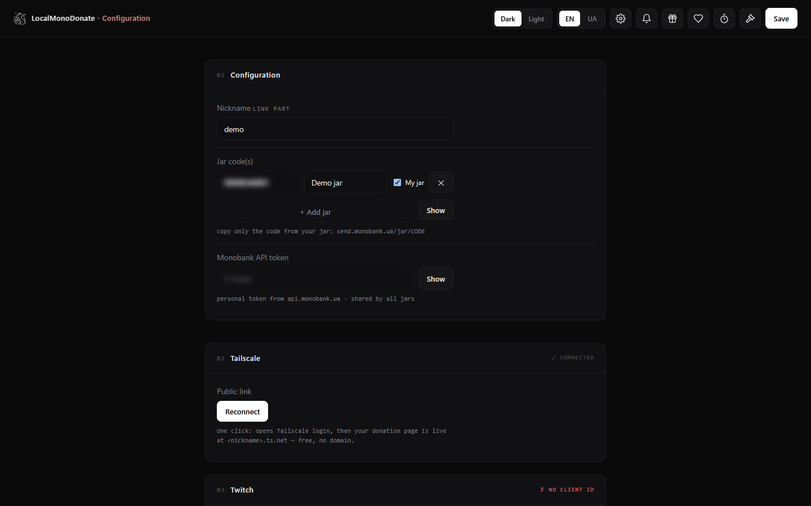
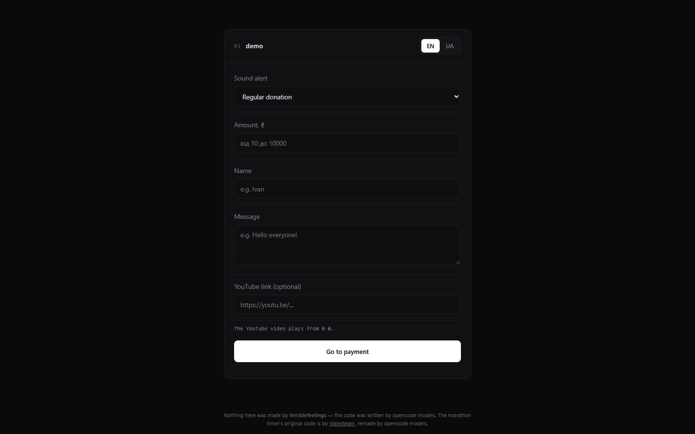
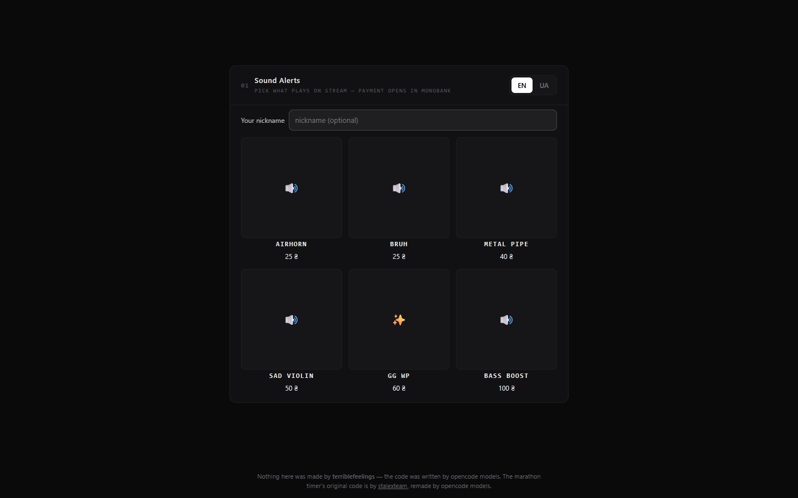
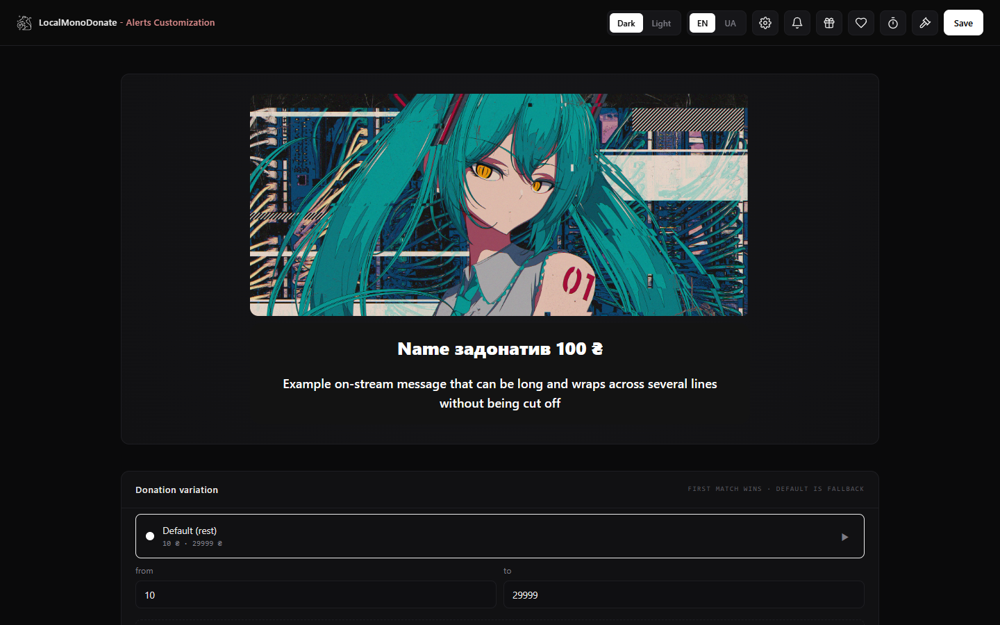
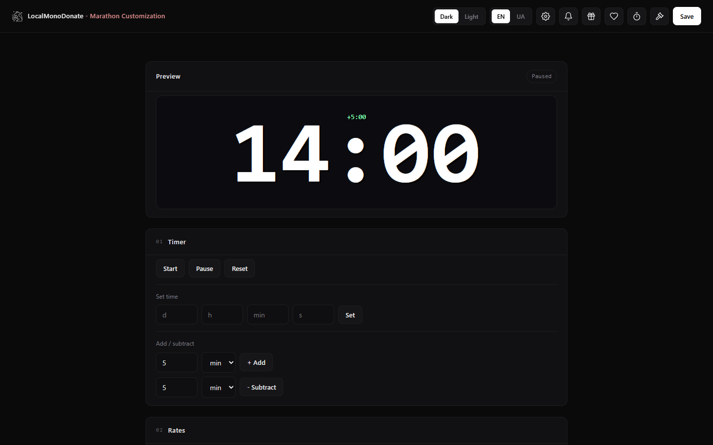
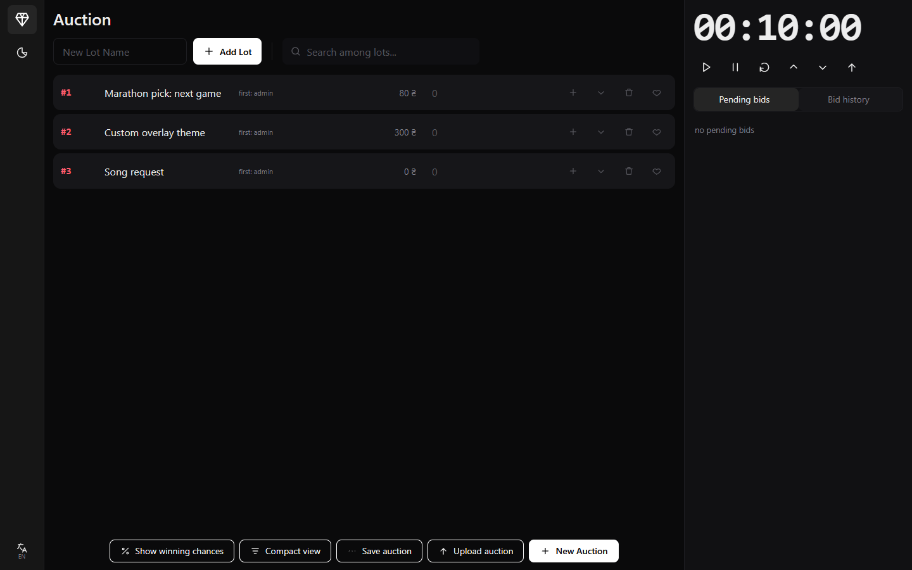

# LocalMonoDonate

Локальний Windows-застосунок для **донат-алертів Monobank**: він відстежує вашу банку (або кілька)
і перетворює вхідні платежі на алерти в ефірі, колоду звукових сповіщень, таймер марафону, аукціон і
тіпи в StreamElements. Один Rust-виконуваний файл із WebView2-інтерфейсом; без хмари й без облікового
запису — назовні йдуть лише запити до API, потрібних для увімкнених функцій.

> Monobank — український банк. Суми показуються у валюті банки (`₴`, `$`, `€`, …).

## Швидкий старт (2 хвилини)

1. Завантажте **`MONOBANK-lite-*.zip`** з [Releases](../../releases) і розпакуйте в будь-яку теку.
2. Запустіть **`LocalMonoDonate.exe`** — відкриється сторінка налаштувань.
3. Вставте **API-токен Monobank** (<https://api.monobank.ua>) і **код банки**
   (`send.monobank.ua/jar/<CODE>`), задайте **нік**, натисніть **Зберегти**.
4. OBS → Browser source → `http://<нік>.overlay.localhost:48973/main` (алерти).
5. Для глядачів → Setup → **Підключити Tailscale** (інсталятор завантажиться автоматично) і поділіться
   `https://<machine>.<tailnet>.ts.net/<нік>/donation`.
6. За бажанням: **Twitch** (Client ID/Secret → Authorize) і **StreamElements**
   (account id + JWT → Test → увімкнути в *Links*).

> **Немає часу?** Кроків 1–3 достатньо для локальних алертів; крок 5 робить сторінку донатів
> доступною для глядачів. Повний посібник і опис кожної функції: **[FAQ](docs/FAQ.md)**.

## Скріншоти

| Налаштування | Сторінка донатів |
|---|---|
|  |  |

| Звукові сповіщення | Стилі алертів |
|---|---|
|  |  |




---

## Функції

### Донати
- Відстежує одну або кілька банок Monobank (до 5) через ваш персональний API-токен.
- Зіставляє платіж із заявкою **за кодом** у коментарі або **за сумою + часом**.
- Заявки створює публічна сторінка донатів (імʼя, сума, повідомлення, посилання на YouTube, голос, звукове сповіщення).
- Кожна позитивна транзакція потрапляє в локальну історію та статистику — незалежно від зіставлення.
- Анонімні донати підтримуються (`Анонім`, якщо нік не вказано).
- Під кнопкою оплати є посилання на ту саму сторінку Monobank: його можна натиснути й утримати, щоб
  відкрити в браузері, якщо застосунок Monobank перехоплює перехід (оплата карткою / Apple Pay / Google Pay).
  Посилання має окремий код; перша оплата з будь-якої вкладки закриває обидві заявки.

### Алерти
- Повноекранний оверлей (`/main`) з власним фоном (зображення/відео) і стилями за діапазонами сум.
- Озвучення донату та звук/голос на оверлеї.
- Редактор правил (`/notify`) — кілька діапазонів сум, у кожного свій стиль, тайминги й текст озвучення.
- YouTube-запит: донат із посиланням відтворює відео **після завершення алерта й озвучення** (+2 с), лише в
  окремому Media-оверлеї (`/youtube`) та одне за раз; нове відео замінює попереднє.
- Медіа-оверлей (`/youtube`) також грає TikTok, Instagram, Twitch-кліпи, Reddit і X; YouTube — з перевірками.
- Оверлеї переживають перезапуск застосунку: сторінки віддаються з `Cache-Control: no-store`, а опитування
  відновлюється автоматично. Якщо OBS запущено раніше за застосунок, зʼявиться попередження; після зміни стилів
  оновіть кеш джерела.
- Приймаються всі поширені варіанти посилань: `youtube.com`, `youtu.be`, `m.`, `music.`, `youtube-nocookie.com`,
  `shorts`, `live`, `embed`, `v`, `e`, `watch_popup`, міжнародні домени (`youtube.co.uk`, `.de`, `.ua` тощо),
  мітки часу та параметри поширення. Посилання, які не ведуть до одного відео (плейлист, кліп, канал,
  пошук), відхиляються.

### QR-віджет
- До 5 оверлеїв: `/qr`, `/qr2` … `/qr5`. У кожного — своя банка, колір фону вікна цілі та стиль:
  **QR + ціль**, **лише QR** або **лише ціль**.
- Окрема сторінка **Налаштування QR-віджетів** (`/qredit`) у навігації застосунку: живий перегляд,
  вирівнювання **верх / середина / низ** (за замовчуванням — низ) і розмір QR **0–200 %** (за замовчуванням — 100 %, 220 px).
- QR веде на публічну сторінку донатів, а вікно показує реальні назву/баланс/ціль банки з Monobank.
- Після донату баланс і ціль оновлюються кожні 60 секунд до 10 хвилин або доти, доки платіж не буде
  зіставлено; далі діє звичайний інтервал статистики.
- Усе налаштовується в Setup і зберігається в `config.json`. Для перевірки 50 % заповнення є тестовий
  лінк `/qr?demo=1` (5 000 із 10 000).

### Оновлення
- На старті застосунок перевіряє останній реліз на GitHub. Якщо версія новіша, у Setup зʼявляється кнопка
  **UPDATE**, яка відкриває сторінку останнього релізу.

### Звукові сповіщення (біти)
- Публічна сторінка Sound Alerts (`/soundalerts`, локально — `/bitsform`) і оверлей `/bits`. Глядач обирає
  кліп за фіксованою ціною; оплата одним токеном, сума перевіряється на сервері.
- Режими на сторінці донатів: **Одне**, **По черзі** та **ADHD** (кілька кліпів одночасно). Кожен режим
  вмикається окремо; типово — «Одне».
- Оверлей грає звук, відео, зображення й готові алерти; відео займає всю висоту джерела без чорних смуг.
  Попередній перегляд показує відео, якщо до кліпу додано відеофайл.
- Необовʼязкове поле ніка: донат записується як `<нік> SA`, без ніка — `Анонім SA`. Так витрати на
  звукові сповіщення не змішуються зі звичайними донатами в статистиці та StreamElements.
- Біт можна додати й до звичайного донату на сторінці донатів.

### Таймер марафону
- Додає час за донат (`сума / per_amount * per_seconds`).
- Додає час за саби Twitch, подарункові саби та ресаби (час для рівнів 1/2/3 налаштовується).
- Керування: старт / пауза / додати / відняти / скинути на `/timeradmin`; оверлей — `/timer`.

### Аукціон
- Ставки з донатів, Twitch channel points і вручну.
- Лоти, закріплення, коригування, фільтр джерел і дедуплікація; окремий інтерфейс (`/auction`).
- Переможець, таймери й історія зберігаються локально.

### Twitch
- Локальний OAuth (публічна адреса повернення не потрібна) + EventSub через WebSocket — **без Cloudflare worker**.
- Читає саби, подарункові саби й ресаби для таймера та використання балів каналу для аукціону.
- Може сам створити нагороди channel points.

### StreamElements
- Кожен живий донат і звукове сповіщення дублюються як **тіп** у StreamElements (у реальній валюті),
  щоб спрацьовував алерт-бокс StreamElements, а також події активності для стрічки та статистики
  панелі (у USD, бо підсумки StreamElements ведуться лише в USD).
- Кнопка перевірки надсилає пʼять службових тіпів із **0 UAH**; вони не потрапляють у статистику.
- Тіпери групуються **лише за ніком**: один нік — один тіпер, різні ніки ніколи не зливаються.
- Жорсткий перемикач: вимкнено — застосунок не надсилає в StreamElements нічого.

### Голоси (TTS)
- **За замовчуванням: Google українська + Google англійська** — безкоштовно, без ключа, потрібне
  підключення до інтернету. Аудіо синтезується у 48 кГц.
- **Microsoft Neural (Edge):** Поліна й Остап для української, Jenny і Guy для англійської. Обираються
  в *Alerts → voice set*; ключ не потрібен, потрібен інтернет.
- **Azure (опційно):** вставте власний ключ Speech і регіон у *Alerts → voice set*; голоси Azure
  зʼявляться у списку лише після цього.
- **Власні голоси StyleTTS2-UA:** потрібна модель StyleTTS2 (~157 МБ) у `tts-engine`; без неї доступні
  Google, Microsoft Neural і Azure, а набір «custom» автоматично ховається.

### Публікація та помічники
- **Tailscale — рекомендований спосіб зробити сторінку донатів публічною** (інсталятор завантажується
  під час встановлення, клієнт оновлюється під час кожного запуску).
- Локальні `*.localhost`-посилання для кожної сторінки — зручно для OBS.
- Інтерфейс українською та англійською з перемиканням на ходу.
- Фони, шрифти, розмір сітки колоди тощо.

---

## Встановлення (Windows 10/11 x64)

Візьміть останній **MONOBANK-lite-*.zip** з [Releases](../../releases), розпакуйте в будь-яку теку та запустіть
`LocalMonoDonate.exe`.

Архів самодостатній:

| Що всередині | Навіщо |
|---|---|
| `LocalMonoDonate.exe` | застосунок |
| `WebView2Loader.dll` | запуск інтерфейсу WebView2 |
| `MicrosoftEdgeWebview2Setup.exe` | тихе встановлення WebView2, якщо його немає |
| `tts-engine\` | портативний Python + голоси Google/Azure, модель StyleTTS2-UA і yt-dlp для Instagram |
| `config.example.json` | лише приклад структури — застосунок його не читає |

Tailscale в архів не входить: інсталятор завантажується під час встановлення, а клієнт перевіряється й
оновлюється під час кожного запуску. Для офлайн-машини зберіть архів із `-WithMsi`.

Окремі Node, Python, Rust та інсталятори для роботи не потрібні. Налаштування й токени створюються під час першого запуску
в `%APPDATA%\LocalMonoDonate\` — ніколи в папці застосунку.

> SmartScreen може попередити, бо exe не підписаний. «Докладніше → Виконати все одно».

---

## Перше налаштування

1. **Токен Monobank** — отримайте персональний токен на <https://api.monobank.ua> (Monobank → Налаштування → API).
   Вставте його в *Setup → Monobank API token*.
2. **Банка** — скопіюйте лише код із посилання `send.monobank.ua/jar/<CODE>`. Додайте його в
   *Setup → Jar code(s)*. Позначте «My jar» (для сторонніх банок буде лише посилання на оплату, без трекінгу).
3. **Нік** — використовується в усіх локальних посиланнях (`<нік>.localhost`). Працюють лише посилання
   з цим префіксом; після зміни ніка старі посилання дають 404.
4. **Збережіть**. Сторінка донатів: `http://<нік>.donate.localhost:48973/banka`.
5. **Tailscale — рекомендований спосіб зробити сторінку доступною глядачам.**
   Сторінка на вашому ПК недоступна з телефона чи іншої мережі.
   Натисніть *Встановити й підключити*: застосунок завантажить і встановить актуальний Tailscale
   (підтвердьте запит Windows), відкриє вхід і після нього ввімкне Funnel. Якщо Funnel ще не дозволений
   у tailnet, натисніть *Увімкнути Funnel* — відкриється <https://login.tailscale.com/f/funnel>. Після
   налаштування натисніть *Підключити* ще раз; сторінка донатів буде доступна за
   `https://<machine>.<tailnet>.ts.net/<нік>/donation`.
6. *(Опційно)* **Twitch** — створіть застосунок на <https://dev.twitch.tv/console/apps> (confidential),
   додайте адресу повернення з Setup, вставте Client ID/Secret і натисніть *Authorize Twitch*.
7. *(Опційно)* **StreamElements** — Settings → Account → скопіюйте account id і JWT (API token).
   Вставте в панель StreamElements, натисніть *Test connection*, увімкніть перемикач у *Links*.

Без токена/банки застосунок теж запускається, але сторінка донатів покаже «No jar configured», а кнопка
оплати буде неактивною.

### Як увімкнути Funnel вручну

Кнопка *Встановити й підключити* завантажує та встановлює Tailscale, відкриває вхід і після входу робить
`tailscale funnel --bg <publicPort>`. Кнопка *Увімкнути Funnel* відкриває сторінку
<https://login.tailscale.com/f/funnel> і додатково повторює локальну команду. Застосунок **не може**
увімкнути HTTPS-сертифікати чи Funnel у політиці tailnet — це робиться в адмінці Tailscale один раз.

1. Переконайтеся, що на ПК виконано вхід у Tailscale (іконка в треї — Connected).
2. <https://login.tailscale.com/admin/dns> → **HTTPS Certificates** → увімкнути.
3. <https://login.tailscale.com/admin/acls> → дозвольте Funnel для вашого tailnet:

   ```json
   "nodeAttrs": [
     { "target": ["autogroup:member"], "attr": ["funnel"] }
   ]
   ```

   Також є сторінка <https://login.tailscale.com/f/funnel>.
4. Виконайте в PowerShell (повний шлях, бо CLI може бути відсутній у PATH):

   ```powershell
   & "C:\Program Files\Tailscale\tailscale.exe" status
   & "C:\Program Files\Tailscale\tailscale.exe" funnel --bg 48975
   & "C:\Program Files\Tailscale\tailscale.exe" funnel status
   ```

   `48975` — це `publicPort` із `config.json` (публічний слухач). **Не 48973** — це локальна адміністративна сторінка.
5. Скопіюйте адресу `https://<machine>.<tailnet>.ts.net`; сторінка донатів —
   `https://<machine>.<tailnet>.ts.net/<нік>/donation`.
6. Локальна перевірка перед публікацією: `http://127.0.0.1:48975/<нік>/donation`.
7. Скинути всі правила: `tailscale funnel reset`.
8. Хочете хост із ніком: `tailscale set --hostname <нік>`, потім перепідключіться — сертифікат
   перевипуститься, і посилання стане `<нік>.<tailnet>.ts.net`. Урахуйте: під час наступного запуску
   застосунок поверне імʼя `ratcorporation`.

Застосунок робить це автоматично: виставляє імʼя вузла `ratcorporation` (посилання
`https://ratcorporation.<tailnet>.ts.net/<нік>/donation`), скидає старі funnel-правила (саме через них
зʼявлялася помилка `Host header is specified…` від Chrome DevTools) і публікує `publicPort`. Якщо
Tailscale піднявся пізніше за застосунок — він повторить спробу протягом хвилини. Після закриття
застосунку Funnel скидається, тож публічного маршруту не залишається.

Якщо `publicPort` зайнятий іншим застосунком, LocalMonoDonate автоматично бере наступний вільний порт,
зберігає його в `config.json` і публікує через Funnel саме його — нічого не треба робити вручну.

Кнопка *Підключити* (Connect) на сторінці Setup робить це сама. Ручні команди вище — лише запасний варіант.

**Поширені помилки**

| Повідомлення | Що зробити |
|---|---|
| `Funnel is not enabled on your tailnet` | крок 3 (ACL / сторінка Funnel) |
| `HTTPS is not enabled` / cert error | крок 2 (HTTPS Certificates) |
| `funnel status` порожній | не виконано `funnel --bg 48975` або немає входу в Tailscale |
| Публічна сторінка 502/порожня | застосунок не запущений або `publicPort` не 48975 |
| Публічна сторінка 404 | неправильний нік у шляху (`/<нік>/donation`) |

Якщо Funnel заборонений політикою організації — `tailscale serve` (лише в межах tailnet), Cloudflare
Tunnel або власний реверс-проксі з HTTPS на `publicPort`.

### Чому Tailscale — стандартний варіант

Посилання `*.localhost` працюють лише на ПК стрімера — OBS їх бачить, глядачі ні. Tailscale Funnel
дає безкоштовну публічну HTTPS-адресу без домену, проброшу портів і проблем із CGNAT. Застосунок керує
Tailscale CLI: один клік на встановлення (інсталятор завантажується автоматично), один вхід — і він тримає funnel на
публічному порту. Досвідчені користувачі можуть замінити це власним реверс-проксі та `publicBase`/`publicPort`,
але UI й посилання розраховані саме на Tailscale.

---

## Сторінки

| Сторінка | Локальне посилання | Публічно через Tailscale |
|---|---|---|
| Налаштування | `http://localhost:48973/setup` | – |
| Сторінка донатів | `http://<нік>.donate.localhost:48973/banka` | `https://<machine>.<tailnet>.ts.net/<нік>/donation` |
| Звукові сповіщення | `http://<нік>.donate.localhost:48973/bits` | `https://<machine>.<tailnet>.ts.net/<нік>/soundalerts` |
| Оверлей алертів (OBS) | `http://<нік>.overlay.localhost:48973/main` | – |
| Оверлей бітів | `http://<нік>.overlay.localhost:48973/bits` | – |
| Оверлей таймера | `http://<нік>.overlay.localhost:48973/timer` | – |
| Оверлей Media | `http://<нік>.overlay.localhost:48973/youtube` | - |
| QR-віджети | `http://<нік>.overlay.localhost:48973/qr`, `/qr2` … `/qr5` | – |
| Налаштування QR | `http://localhost:48973/qredit` | – |
| Аукціон | `http://<нік>.auction.localhost:48973/` | – |
| Статистика | `http://<нік>.<statsCode>.localhost:48973/stats` | – |
| Правила алертів | `http://localhost:48973/notify` | – |
| Налаштування аукціону | `http://localhost:48973/auctionsettings` | – |
| Адмінка таймера | `http://localhost:48973/timeradmin` | – |
| Редактор сторінки донатів | `http://localhost:48973/donateedit` | – |
| Редактор бітів | `http://localhost:48973/bitsedit` | – |

Публічний слухач віддає лише сторінку донатів і колоду звукових сповіщень — жодних адмін-сторінок.

---

## Конфігурація

`config.json` (у `%APPDATA%\LocalMonoDonate\`) зберігає **не секретні** налаштування: нік, назву оверлея,
список банок/назви/прапорці «моя», банка для QR-віджета, правила алертів, таймер, аукціон, біти,
перемикачі функцій, account id StreamElements і стан увімкнення, режим/голос TTS. Ці налаштування
зберігаються між запусками й оновленнями застосунку.

**Секрети зберігаються окремо, для кожного примірника (порту) — саме там застосунок тримає їх, щоб
працювати після перезапуску без повторного вводу:**

```
%APPDATA%\LocalMonoDonate\<port>\token                 API-токен Monobank
%APPDATA%\LocalMonoDonate\<port>\twitch.json           Twitch client id/secret + OAuth-токени
%APPDATA%\LocalMonoDonate\<port>\streamelements.json   StreamElements JWT
```

Сторінка налаштувань показує кожен ключ доступу як текст, розмитий за замовчуванням, із кнопкою Show/Hide.
Видалення файлу скидає лише цей ключ.

Інші шляхи:

```
%APPDATA%\LocalMonoDonate\data.json    стан: банки, історія, таймер, аукціон
%APPDATA%\LocalMonoDonate\media\       зображення/відео, завантажені в редакторах
%APPDATA%\LocalMonoDonate\LocalMonoDonate.log
```

Порти: `48973` (застосунок), `48974` (аукціон), `48975` (публічний/Tailscale); `8787` зарезервований для колбека Twitch. Змінити порти можна в Setup → Ports; застосунок перезапуститься. Якщо порт зайнятий, він чекає кілька секунд і завершується з підказкою, а не змінює посилання самостійно.

---

## Збірка з вихідного коду

Потрібні: Rust (stable), MSVC build tools, WebView2 runtime; Node 18+ — лише для HTTP-тестів.

```powershell
cargo build --release
# чиста збірка для роздачі (exe + WebView2 + tts-engine; без секретів і конфігурації)
powershell -File pack.ps1 -WithTts -TtsEngine <шлях-до-lite-tts-engine>
# для машини без інтернету додайте -WithMsi (вкладе інсталятор Tailscale)
# результат: dist\MONOBANK-lite-<version>.zip
```

`include_str!` вбудовує всі файли з `public/` у exe — **після редагування HTML/JS/CSS потрібна перезбірка**.

Портативний `tts-engine` (venv2 + ffmpeg + serve.py + модель/голоси, ~560 МБ) не зберігається в git —
він є в релізному архіві. `tailscale-setup.msi` теж у git відсутній: застосунок завантажує актуальний
інсталятор сам, тому файл потрібен лише для `-WithMsi`.

### Тести

```powershell
cargo test --release

cd AUC
$env:LMD_DATA = "$env:TEMP\lmd-tests"   # щоб тести не чіпали реальний профіль
node _alltest.mjs       # 190 HTTP-перевірок: сторінки, API, аукціон, донати, таймер, біти, QR
node combotest.mjs      # 33 комбінації аукціону/таймера
node _deeptest.mjs      # кліки в браузері (потрібен playwright-core)
node capture_pages.mjs  # скріншоти
```

---

## Структура проєкту

```
src/main.rs            вікно, WebView2, запуск сервісів
src/app.rs             Ctx: донати, зіставлення, алерти, таймер/аукціон
src/model.rs           конфігурація/стан, шляхи, секрети, посилання, маршрутизація
src/web.rs             tiny_http сервер, сторінки та /api
src/mono.rs            клієнт Monobank (client-info + statements)
src/twitch.rs          OAuth + EventSub (саби, channel points)
src/streamelements.rs  тіпи й події активності (ідентичність за ніком, конвертація в USD)
src/tts.rs             клієнт TTS-демона (Google, Microsoft Neural, Azure, StyleTTS)
src/auction.rs         рушій аукціону
src/tailscale.rs       допоміжник для funnel/публічного посилання
public/                вбудовані сторінки, оверлеї та ресурси
AUC/                   Node-набір HTTP-тестів
pack.ps1               збірка чистого дистрибутива
docs/screenshots/      зображення для README
```

---

## Проблеми та рішення

| Симптом | Що робити |
|---|---|
| `Unknown 'X-Token'` у лозі | токен Monobank неправильний/відкликаний — вставте новий |
| Сторінка донатів каже «No jar configured» | додайте банку в Setup і збережіть |
| Старе посилання відкривається після зміни ніка | так і має бути — 404; скопіюйте нове посилання |
| Глядачі не можуть відкрити сторінку донатів | підключіть Tailscale (публічна адреса), `*.localhost` — лише локально |
| Немає тіпів у StreamElements | увімкніть перемикач у *Links*, натисніть *Test connection*, перевірте журнал |
| Немає голосу | немає TTS-рушія або Google недоступний; для Microsoft Neural потрібен інтернет, для Azure — ключ і регіон |
| Помилка WebView2 під час старту | встановіть WebView2; застосунок запускає вбудований інсталятор тихо |
| Порт зайнятий | закрийте інший екземпляр LocalMonoDonate або змініть порт у Setup → Ports; застосунок не змінює порт самостійно, щоб посилання в OBS не ламалися |
| Алерти або Media не грають в OBS | спершу запустіть LocalMonoDonate, потім OBS; якщо OBS уже відкритий, застосунок покаже попередження, а джерело доведеться оновити |
| Тріщить звук браузерного джерела | у Advanced Audio Properties поставте Audio Monitoring → Monitor Off; у стрім звук усе одно потрапляє |
| Twitch не завершує авторизацію | у застосунку Twitch має бути вказано `http://localhost:8787/twitch/callback`; цей порт фіксований, навіть коли решта застосунку працює на іншому; автоматичний вибір портів ніколи не займає 8787 |
| `Host header is specified and is not an IP address or localhost` | Funnel дивиться на порт Chrome DevTools (9222/9223), а не на `publicPort`: `tailscale funnel reset`, потім `tailscale funnel --bg 48975` |

Логи: `%APPDATA%\LocalMonoDonate\LocalMonoDonate.log`.

---

## Приватність

**Сервера немає.** LocalMonoDonate — локальний застосунок: усе, що він знає (налаштування, банки,
історія донатів, стан таймера/аукціону, завантажені медіа), зберігається в `%APPDATA%\LocalMonoDonate\`
на вашому компʼютері й нікуди не вивантажується.

- Застосунок звертається **лише до API, потрібних для увімкнених функцій**: Monobank (виписки) і, за
  бажанням, Tailscale, Twitch, StreamElements, сервіс курсів валют і Google/Azure TTS.
- Зберігає **лише те, що потрібно для алертів і статистики**: нік донатера, суму, повідомлення, код
  зіставлення й час — без профілів, історії браузера, даних карток чи банківських паролів, без аналітики
  й телеметрії.
- **Ключі доступу** (токен Monobank, Twitch secret/токени, StreamElements JWT) зберігаються локально в
  `%APPDATA%\LocalMonoDonate\<port>\` (ніколи в `config.json`, папці проєкту, HTML/JS, посиланнях, логах
  чи на сервері), показуються в адмінці розмитими, з кнопкою Show/Hide, і надсилаються лише відповідному API через HTTPS.
- **Публічний слухач** віддає лише сторінку донатів і колоду звукових сповіщень; адмінка, оверлеї та
  всі токени залишаються локальними.
- **Видалити все** — закрити застосунок і видалити `%APPDATA%\LocalMonoDonate\`.

Повна політика — що зберігається, куди надсилається, строки зберігання:
**[docs/PRIVACY.md](docs/PRIVACY.md)**.

---

## FAQ

Повний посібник за кожною функцією — **[docs/FAQ.md](docs/FAQ.md)**. Найчастіші питання:

| Питання | Відповідь |
|---|---|
| Мінімум для роботи? | Токен Monobank + код банки в *Setup*, потім Зберегти. |
| Яке посилання давати глядачам? | `https://<machine>.<tailnet>.ts.net/<нік>/donation` (Tailscale). `*.localhost` — лише локально. |
| Як зіставляється платіж? | Код у коментарі (`донат сповіщення <code>`), інакше — сума + остання година. |
| Немає алерта на оверлеї? | Оверлей увімкнено в *Links*, правильний URL в OBS, рекомендовано джерело 750×500 (розмір можна масштабувати). |
| «No jar configured»? | Додайте банку й натисніть Зберегти; інакше кнопка оплати неактивна. |
| Немає звуку/голосу? | `tts-engine` поруч із exe; Google потребує інтернету, Azure — ключа й регіону. |
| Нічого в StreamElements? | Увімкніть перемикач у *Links*, натисніть *Test connection*, перевірте журнал. |
| Один донатер рахується двічі? | SE групує лише за ніком: `goodfeelings` і `goodfeelings2` — різні донатери. |
| Звукові сповіщення окремо? | Так — вони записуються як `<нік> SA` / `Анонім SA`. |
| Де налаштування й секрети? | `%APPDATA%\LocalMonoDonate\config.json` та `<port>\token`, `twitch.json`, `streamelements.json`. |
| Як оновити? | Замініть exe (і `tts-engine`, якщо змінився); налаштування лишаються в `%APPDATA%`. |
| Як скинути? | Закрийте застосунок і видаліть `%APPDATA%\LocalMonoDonate`. |

## Автори та застереження

Це аматорський фанатський інструмент. **Код написали моделі `opencode`**; `terriblefeelings` — ідея, тестування та відгуки зі стрімів.
Оригінальний код таймера марафону — [**stalexteam**](https://github.com/stalexteam),
перероблено для цього застосунку. Той самий текст показано внизу сторінки донатів.

Автори: **terriblefeelings** (ідея, тестування, відгуки зі стрімів) · **opencode** (реалізація).

Не повʼязано з Monobank, Twitch, StreamElements чи Tailscale.

## Участь

Помилки та пропозиції — через [issues](https://github.com/terriblefeelings/LocalMonoDonate/issues/new/choose).
Правила внеску — [CONTRIBUTING.md](CONTRIBUTING.md), політика безпеки — [SECURITY.md](SECURITY.md),
кодекс поведінки — [CODE_OF_CONDUCT.md](CODE_OF_CONDUCT.md).

## Ліцензія

Поширюється за **MIT License** — див. [LICENSE](LICENSE).

QR-код генерується вбудованою бібліотекою [qrcode-generator](https://github.com/kazuhikoarase/qrcode-generator)
1.4.4 (© Kazuhiko Arase, MIT); її заголовок ліцензії збережено в `public/qrcode.js`.

© 2026 [terriblefeelings](https://github.com/terriblefeelings).
