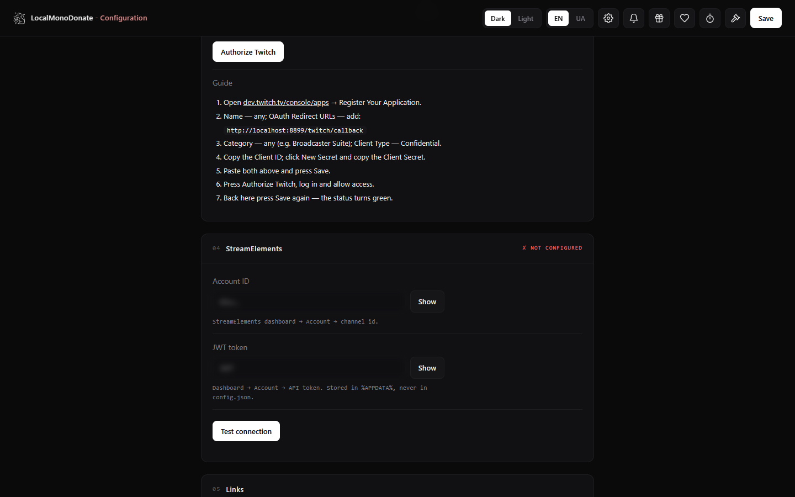

# FAQ — кожна функція окремо

Короткі відповіді та точні налаштування для кожної частини LocalMonoDonate. Усе, що згадується як
`config.json`, `data.json` чи `log`, лежить у `%APPDATA%\LocalMonoDonate\`, якщо не вказано інше.

**Зміст**

1. [Перший запуск і посилання](#1-перший-запуск-і-посилання)
2. [Донати та зіставлення](#2-донати-та-зіставлення)
3. [Оверлей алертів](#3-оверлей-алертів)
4. [Стилі алертів / правила](#4-стилі-алертів--правила)
5. [Звукові сповіщення (біти)](#5-звукові-сповіщення-біти)
6. [Таймер марафону](#6-таймер-марафону)
7. [Аукціон](#7-аукціон)
8. [Twitch](#8-twitch)
9. [StreamElements](#9-streamelements)
10. [Голоси / TTS](#10-голоси--tts)
11. [Tailscale та публічна сторінка](#11-tailscale-та-публічна-сторінка)
12. [YouTube-запити](#12-youtube-запити)
13. [Сторінка статистики](#13-сторінка-статистики)
14. [Конфіг, секрети, порти](#14-конфіг-секрети-порти)
15. [Логи та діагностика](#15-логи-та-діагностика)
16. [Оновлення та бекапи](#16-оновлення-та-бекапи)
17. [Приватність](#17-приватність)
18. [Збірка, тести, пакування](#18-збірка-тести-пакування)
19. [QR-віджет](#19-qr-віджет)

---

## 1. Перший запуск і посилання


**Що мінімально потрібно, щоб застосунок працював?**
API-токен Monobank і хоча б одна банка. Решта — опційно; без банки сторінка донатів показує
«No jar configured», а кнопка оплати неактивна.

**Де взяти токен і код банки?**
Токен: <https://api.monobank.ua> (або Monobank → Налаштування → API). Банка: скопіюйте лише код із
`send.monobank.ua/jar/<CODE>`.

**Яке посилання давати глядачам?**
Ніколи `*.localhost` — це працює лише на вашому ПК (OBS). Для глядачів — Tailscale:
`https://<tailnet>/<нік>/donation`. Див. [§11](#11-tailscale-та-публічна-сторінка).

**Чому старе посилання перестало працювати після зміни ніка?**
Кожен хост має починатися з поточного ніка; `oldname.donate.localhost` тепер віддає 404 — так задумано.

**Що таке «My jar»?**
Зніміть прапорець для сторонньої банки: сторінка донатів дасть посилання на оплату, але застосунок не
бачить її виписок — отже, не буде алертів, кодів чи історії.

**Чи можна кілька банок одночасно?**
Так, до 5. Усі опитуються; у кожної своя історія та статистика.

---

## 2. Донати та зіставлення

**Як застосунок розуміє, до якої заявки належить платіж?**
1. За **кодом**: у коментарі є `донат сповіщення <code>` (код генерує сторінка донатів).
2. Інакше — за **сумою + часом**: та сама банка, сума в межах ±max(1 ₴, 2 %), створено за останню годину.

**Що буде з платежем без заявки?**
Він усе одно потрапить в історію та статистику. Алерт буде лише якщо увімкнено *Notify unmatched*;
імʼя — імʼя відправника з банку, або `Anonymous`, якщо порожнє.

**Чи працюють донати без ніка?**
Так — форма дозволяє порожнє імʼя, застосунок записує **Anonymous** (звукові сповіщення — **Anonymous SA**).

**Відкривається застосунок Monobank замість браузера — як оплатити карткою?**
Після натискання *Перейти до оплати* під кнопкою зʼявляється посилання на ту саму сторінку оплати.
Натисніть і утримуйте його, потім виберіть **«Відкрити в новій вкладці браузера»** — так відкриється
вебверсія банки з оплатою карткою / Apple Pay / Google Pay, без переходу в застосунок.

**Чому між оплатою та алертом є затримка?**
Застосунок опитує Monobank: часто (15 с) одразу після відкриття форми, далі 60 с, потім інтервал
простою (типово 60 с). Це змінюється в `poll_seconds` / `idle_poll_seconds` у `config.json`.

**Чи повторюються старі донати після перезапуску?**
Ні. Під час першого опитування останні 30 днів імпортуються **тихо** (лише історія/статистика).
Алерти дають тільки живі платежі.

**Чи можна повторити алерт?**
Так — кнопка replay в історії знову відтворює донат на оверлеї. Повтор локальний (без тіпа в StreamElements).

---

## 3. Оверлей алертів

**Як додати оверлей в OBS?**
Browser source → `http://<нік>.overlay.localhost:8787/main` (1280×720 або 1920×1080), після зміни стилів —
«Refresh cache of current page».

**Оверлей порожній.**
Перевірте: функція overlay увімкнена в *Links*, відкрито саме URL оверлея (не `/setup`), джерело
прозоре й правильного розміру.

**Які є оверлеї?**
`/main` — донати, `/bits` — звукові сповіщення, `/timer` — таймер, `/youtube` — відео. Усі на
`<нік>.overlay.localhost`.

**Як перевірити алерт без донату?**
На `/notify` є кнопка тесту, або `POST /api/test` з `{ "name": "Test", "amount": 100, "message": "hi" }`.
Тести ніколи не йдуть у StreamElements.

---

## 4. Стилі алертів / правила

**Де редагувати вигляд алертів?**
`/notify` — зліва прев'ю, справа налаштування. У кожного правила діапазон сум (`from`/`to`), тайминги,
шаблон тексту, зображення/фон і поведінка TTS.


**Як вибирається правило?**
Перший відповідний діапазон перемагає; `Default` — запасний для всього поза іншими діапазонами.

**Чи можуть різні суми виглядати по-різному?**
Так — створіть правило на діапазон (напр. 10–99, 100–499, 500+). Вони застосовуються до донатів; звукові
сповіщення мають власний оверлей.

**Звідки беруться зображення/фони?**
Завантажте їх у редакторах (`/donateedit`, `/notify`); файли копіюються в `%APPDATA%\LocalMonoDonate\media\`.

**Плейсхолдери в тексті?**
`%donate%` — імʼя донатера, `%money%` — відформатована сума. Замінюються для кожного алерта.

---

## 5. Звукові сповіщення (біти)

**Що таке «біт»?**
Платне звукове/відео/графічне сповіщення з фіксованою ціною та кодом. Глядач купує його на `/bits`;
код їде в коментарі платежу, застосунок грає його на оверлеї бітів.


**Як створити біти?**
`/bitsedit` — назва, ціна, тип (sound/video/image/alert), URL медіа, опційна картинка кнопки, код.

**Навіщо поле ніка на сторінці звукових сповіщень?**
Для статистики та StreamElements. З ніком алерт рахується як `<нік> SA`, без нього — `Anonymous SA`.
Нік їде в коментарі платежу (`… | name: <нік>`).

**Чи додають біти час таймера та тіпи в SE?**
Додають час як донат, і за увімкненого StreamElements дублюються як тіп `<нік> SA`. Звичайного
донат-алерта вони не створюють.

**Біт нічого не грає.**
Перевірте URL медіа (прямий файл, не сторінка), збіг коду в коментарі та відкритий оверлей бітів.
Перегляд файлу — кнопкою ▶ у колоді.

**Скільки бітів можна мати?**
Жорсткого ліміту немає; сітка колоди — 2–7 колонок (`bits_grid`).

---

## 6. Таймер марафону

**Як додається час?**
`сума / per_amount * per_seconds`, лише для донатів ≥ `min_donation`. Приклад: 10 ₴ → 60 с за
per_amount 10 і per_seconds 60.

**Чи додають час Twitch-саби?**
Так, якщо увімкнено таймер і Twitch: секунди для тірів 1/2/3 окремо; подарункові саби множаться на
кількість подарунків.

**Де керувати?**
`/timeradmin` — старт/пауза/додати/відняти/скинути й редагування правил; оверлей —
`<нік>.overlay.localhost/timer`.


**Таймер зупиняється після перезапуску.**
Так задумано: запущений відлік заморожується під час виходу й продовжується лише після Start.

**Чи можна користуватися таймером без донатів?**
Так — додавайте час вручну в `/timeradmin`; донати лише автоматичне джерело.

---

## 7. Аукціон

**Де аукціон?**
Окрема сторінка на власному порту: `http://<нік>.auction.localhost:8788/` (налаштування —
`/auctionsettings`, вони на головному порту застосунку).


**Звідки ставки?**
Донати (сума ≥ `min_bid`), Twitch channel points і ручні записи в UI аукціону. Джерела можна фільтрувати;
однакові redemption id дедуплікуються.

**Що таке лоти?**
Іменовані предмети, за які йде боротьба. Лоти зʼявляються автоматично зі ставок або створюються/редагуються/
закріплюються в UI; ставки можна коригувати чи видаляти.

**Як вибирається переможець?**
Зважено за сумою ставок серед активних лотів, із ручним перевизначенням. Історія — локальна.

**Чи рахуються ставки як донати?**
Ні: без донат-алерта, без часу таймера, без тіпа в StreamElements.

---

## 8. Twitch

**Що потрібно?**
Застосунок Twitch (confidential) з редіректом із Setup: `http://localhost:8787/twitch/callback`.
Вставте Client ID + Secret, натисніть *Authorize Twitch*, увійдіть.



**Що він читає?**
EventSub WebSocket: `channel.subscribe`, `channel.subscription.gift`, `channel.subscription.message`
(таймер) і `channel.channel_points_custom_reward_redemption.add` (аукціон). Скоупи:
`channel:read:subscriptions channel:read:redemptions channel:manage:redemptions`.

**Чи потрібен публічний URL або Cloudflare worker?**
Ні. OAuth локальний, EventSub підключається назовні через WebSocket.

**Чи створює він нагороди channel points?**
Так, під час першого підключення для аукціону створює (або перевикористовує) нагороди для кожної заданої ціни.

**Токен прострочений / не підключається?**
Переавторизуйтеся в Setup → Authorize Twitch. Токени — у `%APPDATA%\LocalMonoDonate\<port>\twitch.json`.

---

## 9. StreamElements

**Що робить інтеграція?**
Кожен живий донат і звукове сповіщення стає **тіпом** у StreamElements (у реальній валюті), щоб грав
алерт-бокс SE, плюс activity — для стрічки та статистики дашборда.

**Чому суми в дашборді в USD?**
У activity SE немає поля валюти; підсумки SE — у USD. Застосунок конвертує за живим курсом (кеш 6 год)
для activity, а сам тіп лишається в UAH/EUR/USD.

**Як групуються тіпери?**
Лише за **ніком**. Один нік — один тіпер, навіть з іншою карткою/email; різні ніки ніколи не зливаються.
Анонімні донати — `Anonymous`; анонімні звукові сповіщення — `Anonymous SA`.

**Де налаштувати?**
Setup → StreamElements: account id + JWT (Settings → Account → API token), *Test connection*, далі
перемикач у *Links*.

**Чи справді вимкнення все зупиняє?**
Так — з вимкненим перемикачем застосунок не робить жодного запиту до StreamElements (ні тіпа, ні activity,
навіть курсу).

**Нічого не зʼявляється в SE.**
Перевірте лог на рядки `streamelements:`, натисніть *Test connection*, переконайтеся, що донат дав алерт
(зіставлений або дозволений unmatched), і що перемикач увімкнено.

---

## 10. Голоси / TTS

**Що за замовчуванням?**
Google українська + Google англійська — безкоштовно, без ключа, потрібен інтернет.

**Як увімкнути Azure?**
Alerts → voice set → Azure, вставте власний ключ Speech і регіон. Голоси Azure зʼявляться лише після
цього; оплачує Microsoft за вашим тарифом.

**Де кастомні голоси StyleTTS?**
Лише в повних збірках із моделлю StyleTTS2 (~157 МБ). Lite-реліз містить Google/Azure, тому набір
«custom» автоматично ховається.

**Чи може донатер вибрати голос?**
Так, коли набір голосів «ALL» (типово) — форма показує вибір. Інакше використовується голос стрімера.

**Що читається вголос?**
`read_mode`: `message` (повідомлення), `announcement` (шаблон імʼя + сума) або `both`.

**Немає звуку на оверлеї.**
Браузер блокує автоплей — клікніть один раз у прев'ю OBS або дозвольте звук у джерелі. Також перевірте,
що `tts-engine\` лежить поруч із exe.

---

## 11. Tailscale та публічна сторінка

**Чому глядачі не можуть відкрити посилання?**
`*.localhost` існує лише локально. Використовуйте Tailscale: Setup → **Встановити й підключити**.
Застосунок сам поставить Tailscale з комплекту (підтвердьте запит Windows), відкриє вхід і після нього
ввімкне Funnel. Публічна адреса — `https://<tailnet>/<нік>/donation`.

**Funnel не ввімкнувся — що робити?**
Натисніть **Увімкнути Funnel** у Setup: відкриється <https://login.tailscale.com/f/funnel>. Дозвольте
HTTPS-сертифікати та Funnel для цього пристрою, поверніться і натисніть **Підключити** ще раз. Статус
у Setup показує `Funnel on/off`.

**Чи можна змінити імʼя вузла?**
Застосунок сам виставляє `ratcorporation` і скидає старі funnel-правила, тож посилання має вигляд
`https://ratcorporation.<tailnet>.ts.net/<нік>/donation`. Вручну: `tailscale set --hostname ratcorporation`.

**Застосунок сам створює тунель?**
Він ставить Tailscale з комплекту (якщо ще немає), запускає `tailscale up` для входу й тримає
`tailscale funnel` на публічному порту (`8080` типово), з hostname = ваш нік.

**Funnel не створився автоматично — як зробити вручну?**
Увімкніть HTTPS-сертифікати (<https://login.tailscale.com/admin/dns>) і Funnel у політиці tailnet
(<https://login.tailscale.com/admin/acls>, `"attr": ["funnel"]`), потім:

```powershell
& "C:\Program Files\Tailscale\tailscale.exe" funnel --bg 8080
& "C:\Program Files\Tailscale\tailscale.exe" funnel status
```

8080 — це `publicPort` із `config.json`, не 8787. У релізі є `enable-funnel.ps1`: `powershell -ExecutionPolicy Bypass -File enable-funnel.ps1` (додайте `-StatusOnly`, щоб лише подивитися стан). Далі відкрийте
`https://<machine>.<tailnet>.ts.net/<нік>/donation`. Скинути — `tailscale funnel reset`; змінити хост —
`tailscale set --hostname <нік>`. Деталі — в README, розділ «Як увімкнути Funnel вручну».

**Що саме відкрито?**
Лише сторінка донатів і колода звукових сповіщень. Адмінка й оверлеї лишаються локальними.

**Я змінив мережу / перезавантажився.**
Tailscale перепідключається сам; натисніть *Reconnect*, якщо статус не «running».

**Чи можна замість цього власний домен?**
Так, для досвідчених: проброс порту на `publicPort`, власний HTTPS і `public_base` / `public_port` у
`config.json`, щоб посилання вели на ваш домен.

---

## 12. YouTube-запити

**Як це працює?**
Форма донатів приймає YouTube-посилання. Якщо донат досягає `yt_min` правила, відео стартує **після
завершення алерта й озвучення** (ще +2 с), тому воно ніколи не грає одночасно з донатом.

**Які посилання приймаються?**
Усі поширені варіанти: `youtube.com`, `www.`, `m.`, `music.`, `youtu.be`, `yt.be`,
`youtube-nocookie.com`, `youtubekids.com`, `youtube.googleapis.com`, міжнародні домени
(`youtube.co.uk`, `.co.jp`, `.de`, `.fr`, `.ua`, `.com.br` тощо), а також шляхи `/watch?v=`,
`/watch_popup?v=`, `/shorts/`, `/live/`, `/embed/`, `/v/`, `/e/`. Мітки часу (`t=`, `start=`) і
параметри поширення (`si=`, `feature=`) не заважають. Можна вставити голий 11-символьний ID.

**Чому посилання відхилено?**
Потрібне посилання на **одне відео**. Плейлист, кліп, канал, `@handle`, пошук або CDN-адреса не містять
ID відео, тому відхиляються. Правило також може вимагати мінімум переглядів або максимум тривалості
(`yt_views`, `yt_max_min`).

**Де воно грає?**
`<нік>.overlay.localhost/youtube` (окреме джерело OBS), не на оверлеї алертів. Одночасно може грати
лише одне відео: новий донат зупиняє попереднє.

---

## 13. Сторінка статистики

**Де вона?**
`http://<нік>.<statsCode>.localhost:8787/stats` — код генерується кнопкою ↻ у Setup. Перегенерація
робить старе посилання недійсним.

**Що показує?**
Підсумки, топ-донатерів (за ніком; за рівних сум вище той, хто досяг суми раніше), історію з replay,
баланс/ціль кожної банки.

**Чи публічне посилання статистики?**
Ні — `/stats` немає на публічному слухачі. Код — це секрет у URL, не діліться ним.

---

## 14. Конфіг, секрети, порти

**Де налаштування?**
`%APPDATA%\LocalMonoDonate\config.json` (без секретів) і `data.json` (банки/історія/таймер/аукціон).
У папці застосунку нічого не зберігається.

**Де credentials?**
Так, вони зберігаються — локально, щоб застосунок міг опитувати банк і оновлювати токени без повторного
вводу: `%APPDATA%\LocalMonoDonate\<port>\`:

```
token                 API-токен Monobank
twitch.json           client id/secret + OAuth-токени
streamelements.json   StreamElements JWT
```

Вони ніколи не в `config.json`, папці проєкту, HTML/JS, посиланнях, логах чи на сервері. В UI — розмитий
текст із Show/Hide; видалення файлу скидає лише цей credential.

**Чи може застосунок сам вибрати інший порт?**
Так: якщо `publicPort` зайнятий, він бере наступний вільний, записує його в `config.json` і публікує через Funnel саме цей порт. `port` і `auctionPort` так не змінюються.

**Як змінити порти?**
Змініть `port`, `auctionPort`, `publicPort` у `config.json` і перезапустіть. Усі локальні посилання
використовують `port`.

**Чи можна перенести застосунок?**
Так — папка портативна; налаштування лишаються в `%APPDATA%`.

---

## 15. Логи та діагностика

**Де лог?**
`%APPDATA%\LocalMonoDonate\LocalMonoDonate.log`.

| Лог / симптом | Значення |
|---|---|
| `Unknown 'X-Token'` | токен Monobank неправильний/відкликаний |
| `HTTP 429` від Monobank | забагато запитів — збільште `poll_seconds` |
| `streamelements: HTTP 401` | JWT SE прострочений — вставте новий |
| `tts daemon unavailable` | немає `tts-engine` або його заблоковано |
| Порожня сторінка донатів | немає банки / сторінку вимкнено в *Links* |
| `Host header is specified and is not an IP address or localhost` | Funnel веде на порт Chrome DevTools (9222/9223), а не на `publicPort`: `tailscale funnel reset`, потім `tailscale funnel --bg 8080` |

**Помилка WebView2 під час старту?**
Встановіть WebView2 (застосунок запускає вбудований інсталятор тихо).

**Порт зайнятий?**
Змініть `port` у `config.json`; порт аукціону має відрізнятися.

---

## 16. Оновлення та бекапи

**Як оновитися?**
На старті застосунок перевіряє останній реліз на GitHub. Якщо є новіша версія, у Setup зʼявляється
кнопка **UPDATE** (праворуч угорі) — вона відкриває сторінку останнього релізу. Оновитися можна й вручну:
замініть `LocalMonoDonate.exe` (і `tts-engine\`, якщо реліз змінив його) — налаштування й секрети
лишаються в `%APPDATA%`.

**Як зробити бекап?**
Скопіюйте `%APPDATA%\LocalMonoDonate\` (конфіг, дані, токени, медіа). Ніколи не комітьте це.

**Як скинути все?**
Закрийте застосунок і видаліть цю папку; наступний запуск буде чистим.

---

## 17. Приватність

**Чи є сервер, що зберігає мої дані?**
Ні. Застосунок повністю локальний: налаштування, історія, стан таймера/аукціону й медіа лежать у
`%APPDATA%\LocalMonoDonate\` на вашому ПК. Нічого не надсилається авторові чи в хмару.

**Що виходить з мого компʼютера?**
Лише запити для увімкнених функцій: Monobank API і, за бажанням, Tailscale, Twitch, StreamElements,
сервіс курсів (конвертація для SE) та Google/Azure TTS. Один запит до GitHub API перевіряє наявність
нової версії (нічого не надсилає про вас). Без аналітики й телеметрії.

**Що саме зберігається про глядачів?**
Лише те, що потрібно алерту: нік, сума, повідомлення, код зіставлення й час — те саме, що вже є у
виписці банку. Без профілів, email чи даних карток.

**Чи токени потрапляють у браузер?**
Лише на локальну адмінку (`/setup`), розмитими з Show/Hide, щоб власник міг їх редагувати. Вони не
вбудовані в HTML/посилання, не віддаються публічному слухачу й не покидають
`%APPDATA%\LocalMonoDonate\<port>\`, крім запитів до відповідного API через HTTPS.

**Як видалити все?**
Закрийте застосунок і видаліть `%APPDATA%\LocalMonoDonate\`.

Повна політика: [docs/PRIVACY.md](PRIVACY.md).

---

## 18. Збірка, тести, пакування

**Збірка**
```powershell
cargo build --release
```
`public/` вбудовується через `include_str!` — після редагування HTML/JS/CSS потрібна перезбірка.

**Тести**
```powershell
cargo test --release
cd AUC
$env:LMD_DATA = "$env:TEMP\lmd-tests"   # ізоляція від реального профілю
node _alltest.mjs
node combotest.mjs
node _deeptest.mjs        # потрібен playwright-core
```

**Пакування**
```powershell
powershell -File pack.ps1 -WithTts -TtsEngine <шлях-до-lite-tts-engine>
```
Створює `dist\MONOBANK-lite-<version>.zip`: exe, WebView2 loader/інсталятор, Tailscale MSI, TTS-рушій
і порожній `config.example.json`; без конфігу, секретів і медіа.

---

## 19. QR-віджет

**Що це?**
До 5 оверлеїв для OBS: `/qr`, `/qr2` … `/qr5`. У кожного своя банка, колір фону вікна цілі та стиль:
**QR + ціль**, **лише QR** або **лише ціль**. QR веде на сторінку донатів, вікно показує назву банки,
зібрану суму та ціль.

**Як налаштувати?**
Setup → **QR Widget Customization** (або `http://localhost:8787/qredit`): додайте віджети (до 5), для
кожного виберіть банку, колір фону та стиль; там же — вирівнювання **верх / середина / низ** (типово низ)
і розмір QR **0–200 %**. Усе зберігається в `config.json`; посилання `/qr`, `/qr2` … зʼявляються в *Links*.

**Куди веде QR?**
На публічну сторінку донатів (`https://<tailnet>/<нік>/donation`), якщо підключено Tailscale; інакше —
на локальну `<нік>.donate.localhost`. Тому для телефонів увімкніть Tailscale.

**Оновлення даних?**
Віджет опитує стан кожні 4 секунди. Після донату застосунок оновлює баланс/ціль банки через API кожні
60 секунд до 10 хвилин або доти, доки платіж не буде зіставлено; далі діє звичайний інтервал статистики.
Сума показується в гривнях (копійки з API перераховуються).

**Як перевірити заповнення смуги?**
На сторінці **QR Widget Customization** є посилання *Тестовий QR: 5 000 / 10 000*. Воно відкриває
`/qr?demo=1` зі статичними 5 000 із 10 000 (50 %) — зручно перевірити градієнт без реального донату.
Тестовий віджет бере стиль, колір і банку першого (типового) віджета.
